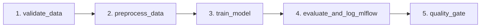
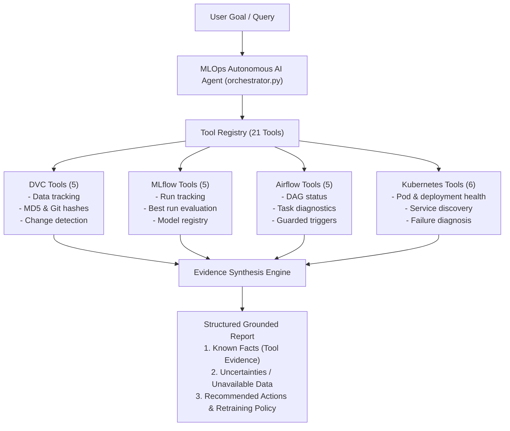

# Assignment 03: Building a Production-Ready MLOps AI Agent

A production-grade, autonomous AI Agent that manages end-to-end Machine Learning Operations (MLOps) workflows across data versioning, experiment tracking, workflow scheduling, and Kubernetes deployments.

---

## 1. Project Overview

The **MLOps AI Agent** bridges the gap between natural language developer intentions and production infrastructure. Given a goal such as *"Train model on new data, verify metrics exceed thresholds, register in MLflow, and deploy to Kubernetes"*, the agent:
1. Plans and reasons over MLOps operational steps.
2. Interacts with **DVC** for dataset & artifact reproducibility.
3. Tracks metrics, parameters, and registers artifacts with **MLflow**.
4. Triggers and monitors asynchronous DAG pipelines in **Apache Airflow**.
5. Validates deployment policies and applies zero-downtime manifests in **Kubernetes**.
6. Enforces enterprise guardrails, strict namespace isolation, and automatic secret redaction.

---

## 2. Architecture Summary

The agent architecture comprises four major layers:
- **Reasoning & Orchestration Layer**: Autonomous LLM planner coordinating step-by-step tool actions.
- **Guardrail & Safety Layer**: Enforces namespace constraints (`mlops-prod` only), metric thresholds, and credential masking.
- **Tool Domain Layer**: Standardized Pydantic v2 execution interfaces for DVC, MLflow, Airflow, and Kubernetes.
- **Observability Layer**: Structured JSON logging capturing `request_id`, `tool_name`, `status` (`SUCCESS`, `ERROR`, `BLOCKED`), and `duration_ms`.

Detailed architecture diagrams and workflows are available in [architecture.md](architecture.md).

---

## 3. Directory Structure

```
├── .github/
│   └── workflows/
│       └── ci.yml                 # GitHub Actions CI workflow (linting & testing)
├── agent/
│   ├── __init__.py                # Package exports
│   ├── logger.py                  # Structured JSON logger with secret redaction
│   ├── main.py                    # Agent CLI entrypoint
│   ├── orchestrator.py            # Workflow orchestration & planning engine
│   ├── schemas.py                 # Pydantic v2 domain schemas & ToolExecutionResult
│   └── tools/
│       ├── __init__.py
│       ├── airflow_tools.py       # Airflow 3 REST API client integration
│       ├── dvc_tools.py           # DVC CLI/API tracking & reproduction
│       ├── kubernetes_tools.py    # K8s deployment, health, rollback & guardrails
│       └── mlflow_tools.py        # MLflow tracking and registry operations
├── api/
│   ├── __init__.py
│   └── main.py                    # FastAPI model inference & health service
├── dags/
│   └── training_pipeline.py       # Airflow training pipeline DAG
├── data/
│   └── .gitkeep                   # Dataset directory tracked by DVC
├── kubernetes/
│   ├── configmap.yaml             # API configuration and environment settings
│   ├── deployment.yaml            # Rolling update deployment manifest
│   └── service.yaml               # ClusterIP service definition
├── screenshots/
│   └── .gitkeep                   # Verification screenshots
├── tests/
│   └── __init__.py                # Automated test suite
├── training/
│   ├── __init__.py
│   └── train.py                   # Model training script with MLflow logging
├── .env.example                   # Environment variable template
├── .gitignore                     # Git ignore rules for MLOps artifacts
├── Dockerfile                     # Container image specification for model API
├── dvc.yaml                       # DVC reproducible pipeline stages
├── pyproject.toml                 # Project metadata and dependencies
├── architecture.md                # System design & architecture documentation
└── README.md                      # Project documentation
```

---

## 4. Getting Started

### 4.1 Prerequisites
- Python >= 3.10 (Python 3.11 recommended)
- Git (configured locally)
- (Optional) Docker, Minikube / Kind for local Kubernetes testing

### 4.2 Virtual Environment Setup

Create and activate a virtual environment:

```bash
# Windows (PowerShell)
python -m venv .venv
.\.venv\Scripts\Activate.ps1

# Linux / macOS
python3 -m venv .venv
source .venv/bin/activate
```

### 4.3 Dependency Installation

Install the project in editable mode with development dependencies:

```bash
pip install --upgrade pip
pip install -e ".[dev]"
```

### 4.4 Environment Configuration

Copy `.env.example` to `.env` and configure your API keys and endpoints:

```bash
cp .env.example .env
```

Key environment variables:
- `LLM_API_KEY`: API key for Gemini or OpenAI-compatible model provider.
- `LLM_MODEL`: Target model (e.g., `gemini-2.5-flash`).
- `MLFLOW_TRACKING_URI`: MLflow tracking server (default: `http://localhost:5000`).
- `AIRFLOW_BASE_URL`: Airflow 3 API base URL (default: `http://localhost:8080/api/v2`).
- `K8S_APPROVED_NAMESPACE`: Permitted Kubernetes deployment namespace (`mlops-prod`).
- `DVC_REMOTE_NAME`: DVC remote storage identifier (`local_remote`).

---

## 5. Running the Agent & Services

### Running the Agent CLI
```bash
python -m agent.main --goal "Train iris model and deploy to mlops-prod"
```

### Running the Inference API Locally
```bash
uvicorn api.main:app --host 0.0.0.0 --port 8000 --reload
```
Access the interactive API docs at [http://localhost:8000/docs](http://localhost:8000/docs).

### Running Tests and Linting
```bash
# Run test suite
pytest

# Run linter
ruff check .
```

---

## 6. Task 1: DVC Data Management

The DVC Data Management Agent (`agent/tools/dvc_tools.py`) provides safe, allowlisted subprocess interactions with DVC and Git to inspect, track, compare, and reproduce dataset versions. Every call returns a standardized `ToolExecutionResult` from `agent/schemas.py` and emits structured JSON logs with secret redaction.

### 6.1 Dataset Generation & DVC Pipeline Setup

1. **Generate Synthetic Classification Data**:
   ```bash
   # Generate v1 baseline dataset (1,000 samples)
   python -m training.generate_data --version v1 --output data/dataset.csv

   # Optionally generate v2 drifted dataset (1,250 samples)
   python -m training.generate_data --version v2 --output data/dataset.csv
   ```

2. **Initialize DVC and Configure Local Remote Storage**:
   ```bash
   dvc init
   dvc remote add -d local_remote .dvc_storage
   ```

3. **Track Dataset with DVC**:
   ```bash
   dvc add data/dataset.csv
   dvc push
   ```

4. **Run Reproducible Pipeline (`dvc.yaml`)**:
   ```bash
   dvc repro
   ```
   This executes the two-stage reproducible pipeline:
   - `validate_data`: checks schema, row count, nulls, and emits `data/validation_report.json`.
   - `train`: trains Random Forest model, outputs `models/model.joblib`, and writes `metrics.json`.

### 6.2 DVC Agent Tools

The 5 callable tools in `agent/tools/dvc_tools.py` include:

| Tool Function | Description |
|---|---|
| `list_dvc_tracked_datasets()` | Scans repository for `.dvc` files and pipeline datasets. |
| `get_current_dataset_version()` | Retrieves MD5 hash, dataset version label, Git commit, and DVC remote. |
| `compare_dataset_versions(rev1, rev2)` | Computes hash and size differences between revisions or states. |
| `detect_data_changes()` | Checks `dvc status` to detect modified data or pipeline dependencies. |
| `explain_dataset_reproduction(rev)` | Returns exact, verified commands to reproduce a previous dataset version. |

### 6.3 Security & Allowlist Enforcement

All subprocess calls enforce strict security rules:
- **No `shell=True`**: All commands are executed as parameter lists.
- **Root Command Allowlist**: Only `dvc` and `git` are permitted.
- **Subcommand Allowlist**: Strictly limited to read-only or approved operations (`status`, `list`, `diff`, `metrics`, `params`, `remote`, `checkout`, `pull`, `push`, `repro`, `dag`, `rev-parse`, `log`, `show`).
- **Shell Injection Prevention**: Arguments are checked for forbidden characters (`;`, `&`, `|`, `` ` ``, `$`, `>`, `<`).

### 6.4 Running Task 1 Tests

Run the automated test suite for the DVC tools:

```bash
pytest tests/test_dvc_tools.py -v
```

---

## 7. Task 2: MLflow Experiment Intelligence

The MLflow Experiment Intelligence Agent (`agent/tools/mlflow_tools.py`) uses `mlflow.tracking.MlflowClient` exclusively to programmatically audit experiments, evaluate candidate runs against multi-criteria production readiness policies, compare model performance trade-offs, and inspect the MLflow Model Registry.

### 7.1 Running the Modular Training Pipeline

The training script (`training/train.py`) executes a modular scikit-learn training workflow:
- **Data Validation**: Asserts schema, row count (>= 50), missingness, and minority class balance.
- **Preprocessing**: Stratified train/test splitting (`X_train`, `X_test`, `y_train`, `y_test`).
- **Model Training**: Configurable between Random Forest, Gradient Boosting, and Logistic Regression.
- **Evaluation**: Computes accuracy, precision, recall, F1 score, ROC-AUC, and train-test overfitting gap.
- **Quality Gate**: Asserts minimum F1 threshold (`>= 0.75`) and bounded overfitting gap (`<= 0.20`).
- **Provenance Logging**: Automatically logs hyperparameters, metrics, model artifacts, and provenance tags (`dataset_version`, `dvc_md5`, `git_commit`, `quality_gate_passed`, `quality_gate_reason`).

#### Example Training Commands:
```bash
# 1. Balanced Random Forest (Baseline - Passes Quality Gate)
python -m training.train --model-type random_forest --n-estimators 100 --max-depth 5

# 2. High-Complexity Random Forest (High capacity / Overfitting evaluation)
python -m training.train --model-type random_forest --n-estimators 250 --max-depth 15

# 3. Gradient Boosting Classifier (High performance)
python -m training.train --model-type gradient_boosting --n-estimators 100 --learning-rate 0.08 --max-depth 3

# 4. Logistic Regression (Linear model)
python -m training.train --model-type logistic_regression --c-param 1.0

# 5. Underfitted Random Forest (Fails Quality Gate: F1 < 0.75)
python -m training.train --model-type random_forest --n-estimators 5 --max-depth 1 --min-f1 0.75
```

### 7.2 Launching the MLflow UI

View experiments, metrics curves, and the Model Registry in the browser:

```bash
# Launch MLflow UI connected to the SQLite backend
mlflow ui --backend-store-uri sqlite:///mlflow.db --port 5000
```
Open [http://localhost:5000](http://localhost:5000) in your web browser.

### 7.3 MLflow Agent Tools

The 5 callable tools in `agent/tools/mlflow_tools.py` include:

| Tool Function | Description |
|---|---|
| `list_experiments_and_runs()` | Lists active experiments and recent training runs with statuses, timestamps, and parameters. |
| `get_run_details(run_id)` | Retrieves full metrics, hyperparameters, artifact paths, and dataset provenance tags (`dataset_version`, `git_commit`, `dvc_md5`). |
| `find_best_run(exp, metric, min_threshold)` | Finds top-performing candidate and performs comprehensive production-readiness check (quality gate, overfitting gap, provenance audit). **Explicitly verifies that highest metric score alone does not guarantee production readiness.** |
| `compare_runs(run_ids)` | Side-by-side comparative matrix across metrics, hyperparameters, and dataset versions with trade-off analysis. |
| `get_model_registry_info(model_name)` | Inspects registered models, current versions, lifecycle stages, and aliases. |

### 7.4 Running Task 2 Tests

Run the automated test suite for the MLflow intelligence tools:

```bash
pytest tests/test_mlflow_tools.py -v
```

---

## 8. Task 3: Apache Airflow Workflow Automation

The Airflow Workflow Automation Agent (`agent/tools/airflow_tools.py`) and training DAG (`dags/training_pipeline.py`) provide end-to-end orchestration and asynchronous management of model training pipelines through the Airflow 3 / 2 REST API.

### 8.1 5-Stage Airflow DAG Architecture (`mlops_model_training_pipeline`)

The DAG organizes the end-to-end pipeline into 5 strictly sequential stages:



1. **`validate_data`**: Asserts `data/dataset.csv` exists, has at least 50 records, contains required target column, has null ratio `<= 0.05`, and captures the DVC content hash. Raises `ValueError` to abort the pipeline early on invalid data.
2. **`preprocess_data`**: Splits features and target with stratification, writing partitioned numpy arrays to `data/processed/`.
3. **`train_model`**: Trains the Random Forest classifier and checkpoints the model to `models/candidate_model.joblib`.
4. **`evaluate_and_log_mlflow`**: Evaluates model metrics (Accuracy, Precision, Recall, F1, ROC-AUC), logs parameters and tags (`git_commit`, `dvc_md5`) to MLflow, and exports cloudpickle model artifacts.
5. **`quality_gate`**: Evaluates candidate model performance against strict production thresholds (`f1_score >= 0.75` and `accuracy >= 0.75`). If criteria fail, raises a `RuntimeError` to block deployment; if criteria pass, promotes/registers the model in the MLflow Model Registry.

### 8.2 Execution & Configuration

The DAG tasks can be tested standalone or scheduled within Apache Airflow:

```bash
# Test all 5 DAG stages standalone in Python
python -c "
from dags.training_pipeline import *
task_validate_data()
task_preprocess_data()
task_train_model()
task_evaluate_and_log_mlflow()
task_quality_gate()
"
```

Configure your Airflow connection in `.env`:
- `AIRFLOW_BASE_URL`: Airflow API endpoint (default: `http://localhost:8080/api/v2`).
- `AIRFLOW_USERNAME`: Basic auth username.
- `AIRFLOW_PASSWORD`: Basic auth password.
- `AIRFLOW_API_TOKEN`: Optional Bearer token authentication.

### 8.3 Airflow Agent Tools & Security Guardrails

The 5 callable tools in `agent/tools/airflow_tools.py` include:

| Tool Function | Description |
|---|---|
| `list_available_dags()` | Queries `/dags` to retrieve available DAGs, pause status, and schedules. |
| `get_dag_run_status(dag_id, dag_run_id)` | Inspects execution state (`queued`, `running`, `success`, `failed`) and run timestamps. |
| `trigger_training_dag(dag_id, conf)` | Validates DAG against `APPROVED_DAGS` allowlist and triggers a new run via POST `/dags/{dag_id}/dagRuns`. **Rejects unapproved DAGs with `BLOCKED` status.** |
| `identify_failed_tasks(dag_id, dag_run_id)` | Queries task instances to detect failed or upstream-failed tasks. |
| `get_task_diagnostics(dag_id, dag_run_id, task_id)` | Fetches task logs and analyzes error patterns to provide actionable remediation steps. |

### 8.4 Running Task 3 Tests

Run the automated test suite for the Airflow DAG and workflow tools:

```bash
pytest tests/test_airflow_tools.py -v
```

---

## 9. Task 4: FastAPI Inference Service, Docker, and Kubernetes Operations

Task 4 provides production model serving, containerization, declarative Kubernetes infrastructure, and the autonomous Kubernetes Operations Agent (`agent/tools/kubernetes_tools.py`) for cluster health auditing, automated failure diagnosis, and guarded lifecycle management.

### 9.1 FastAPI Model Serving Microservice (`api/main.py`)

The inference service is built with FastAPI and exposes standardized Kubernetes health probes, runtime version provenance, and real-time model inference:

| Endpoint | Method | Purpose | Response Payload |
|---|---|---|---|
| `/healthz` | GET | Liveness probe: verifies application process is running and event loop is responsive. | `{"status": "alive", "timestamp": "..."}` |
| `/readyz` | GET | Readiness probe: confirms the model checkpoint is loaded and operational. Returns 503 if unloaded. | `{"status": "ready", "model_loaded": true, "expected_features": 6}` |
| `/version` | GET | Release audit: returns deployed application tag, model version, environment, and linked DVC dataset version. | `{"app_version": "1.2.0", "model_version": "1.2.0", "dvc_dataset_version": "v1.0.0", "environment": "mlops-prod"}` |
| `/predict` | POST | Real-time classification inference: parses numeric feature vectors or named fields and returns class prediction and probabilities. | `{"prediction": 0, "confidence": 0.91, "probabilities": [0.91, 0.09], "model_name": "mlops-classifier", ...}` |

#### Testing the API locally:

```bash
# Start the serving API
uvicorn api.main:app --host 0.0.0.0 --port 8000

# Perform real-time inference via curl
curl -X POST "http://localhost:8000/predict" \
  -H "Content-Type: application/json" \
  -d '{"features": [1.5, -0.2, 2.1, 0.8, -0.5, 1.2]}'
```

### 9.2 Containerization (`Dockerfile`)

A multi-stage, hardened Docker image based on `python:3.11-slim`:

```bash
# Build the production Docker image
docker build -t mlops-inference-api:1.2.0 .

# Run the container locally with port binding
docker run -p 8000:8000 --name mlops-api mlops-inference-api:1.2.0
```

### 9.3 Kubernetes Production Manifests (`kubernetes/`)

The infrastructure definitions target the isolated production namespace `mlops-prod`:

1. **`kubernetes/configmap.yaml` (`mlops-inference-config`)**:
   Contains non-sensitive environment configuration: `APP_VERSION: "1.2.0"`, `MODEL_NAME: "mlops-classifier"`, `MODEL_VERSION: "1.2.0"`, `DVC_DATASET_VERSION: "v1.0.0"`, `LOG_LEVEL: "INFO"`, and `MLFLOW_TRACKING_URI`.
2. **`kubernetes/deployment.yaml` (`mlops-inference-deployment`)**:
   Deploys `mlops-inference-api:1.2.0` with:
   - High availability: `replicas: 2` with `RollingUpdate` strategy (`maxSurge: 1`, `maxUnavailable: 0`).
   - Liveness probe: HTTP GET `/healthz` on port 8000.
   - Readiness probe: HTTP GET `/readyz` on port 8000.
   - Resource governance: Explicit requests (`cpu: 100m`, `memory: 128Mi`) and limits (`cpu: 500m`, `memory: 512Mi`).
3. **`kubernetes/service.yaml` (`mlops-inference-service`)**:
   Internal `ClusterIP` load balancer routing internal cluster port 80 to container port 8000.

#### Deploying to Kubernetes:

```bash
# Create target namespace if not already existing
kubectl create namespace mlops-prod --dry-run=client -o yaml | kubectl apply -f -

# Apply all manifests
kubectl apply -f kubernetes/
```

### 9.4 Kubernetes Operations Agent Tools & Enterprise Guardrails

The Kubernetes Operations Agent (`agent/tools/kubernetes_tools.py`) interacts with the Kubernetes cluster using the official `kubernetes` Python client (`CoreV1Api`, `AppsV1Api`).

#### Strict Safety Guardrails:
1. **Strict Namespace Isolation**:
   All tools enforce namespace restriction via `validate_namespace()`. Operations targeting any namespace other than the approved production namespace (default: `mlops-prod`, configurable via `K8S_APPROVED_NAMESPACE`) are **immediately rejected with status `BLOCKED`**.
2. **State Mutation Confirmation Gate**:
   Read-only inspections (listing, logs, service checks) execute safely. State-changing operations (`scale_or_restart_deployment`) strictly require `user_confirmed: bool = True`. Unconfirmed requests return status `BLOCKED` with a detailed confirmation request payload without altering cluster state.

#### The 6 Callable Kubernetes Agent Tools:

| Tool Function | Description |
|---|---|
| `list_pods_and_deployments(namespace)` | Lists all running pods, phases, container readiness, restart counts, and deployment replica health (desired, ready, available). |
| `get_pod_status_and_logs(pod_name, namespace, tail_lines)` | Retrieves detailed container lifecycle states (running, waiting, terminated) and recent log tail for rapid troubleshooting. |
| `inspect_services(namespace)` | Lists Kubernetes services, ClusterIPs, port bindings, and label selectors. |
| `diagnose_unhealthy_pods(namespace)` | Automated diagnostic engine scanning for `CrashLoopBackOff`, `OOMKilled`, `ImagePullBackOff`, `Pending`, and readiness probe failures with actionable remediation steps. |
| `get_deployed_app_version(namespace)` | Inspects deployed container images and active ConfigMap values to audit active release and model version provenance. |
| `scale_or_restart_deployment(...)` | Safely scales replica count or initiates rolling restart (via pod template annotations). **Enforces explicit confirmation gate (`user_confirmed=True`).** |

### 9.5 Running Task 4 Tests

Run the automated test suites for the inference API and Kubernetes operations tools:

```bash
# Run API endpoint tests
pytest tests/test_api.py -v

# Run Kubernetes operations agent tests
pytest tests/test_kubernetes_tools.py -v
```

---

## 10. Phase 5: Autonomous Multi-Tool Agent Orchestrator & CLI

The **Intelligent Multi-Tool Agent** integrates the four specialized domains (DVC, MLflow, Airflow, and Kubernetes) into a unified, autonomous orchestration engine ([`agent/orchestrator.py`](agent/orchestrator.py)) controlled via a versatile Command Line Interface ([`agent/main.py`](agent/main.py)).

### 10.1 Orchestrator Architecture & Reasoning Engine

The orchestrator manages 21 registered tools across the four MLOps domains:



#### Dual Execution Strategy:
1. **LLM Function Calling**:
   Uses Google Gemini (`google.genai`) or OpenAI-compatible APIs (`openai`) configured via `.env` (`LLM_PROVIDER`, `LLM_API_KEY`, `LLM_MODEL`). Executes dynamic multi-turn tool-calling loops with strict system grounding.
2. **Deterministic Rule-Aware Router (Offline & CI Fallback)**:
   When running offline, without an LLM key, or if network connectivity is unavailable, the orchestrator seamlessly activates an intelligent, rule-aware router that analyzes user goal semantics, coordinates the appropriate multi-tool chain, and synthesizes grounded reports.

#### System Prompt & Enterprise Reasoning Constraints:
- **Strict Grounding**: Every operational claim must cite specific tool outputs (Run IDs, F1 scores, DVC MD5 hashes, Git commit SHAs, Pod phases, or DAG execution states). The agent **never** invents or hallucinates telemetry.
- **Transparent Outage Reporting**: If a service (such as Airflow REST API or Kubernetes apiserver) is offline or unreachable, the agent explicitly documents the failure under `Uncertainties / Unavailable Data` rather than guessing state.
- **Mandatory Retraining Policy**:
  - The agent **never** triggers Airflow retraining automatically when asked whether retraining is needed.
  - Retraining is recommended **only** when supported by concrete tool evidence: uncommitted dataset drift, failed quality gates, degraded metric thresholds, or upstream pipeline failures.
  - When the model satisfies production thresholds, the dataset is clean, and the deployment is healthy, the agent explicitly concludes that **no retraining is necessary**.

---

### 10.2 Command Line Interface Modes (`agent/main.py`)

The agent CLI supports single-query execution, automated JSON pipelines, and full interactive sessions:

#### Mode 1: Single-Query CLI (`--query` / `--goal`)
```bash
python -m agent.main --query "Find the best recent model, identify the dataset version used to train it, check the deployment status, and explain whether retraining is necessary."
```

#### Mode 2: Automated JSON Output (`--json`)
Emits a structured JSON payload conforming to the `AgentResponse` schema, capturing `request_id`, `goal`, `status`, `steps_executed` (with duration and data), and `summary`:
```bash
python -m agent.main --query "Find the best recent model and check deployment status" --json
```

#### Mode 3: Interactive REPL Mode
```bash
python -m agent.main
```
Commands within the interactive session:
- `help`: Displays sample queries for all 5 evaluation scenarios.
- `tools`: Lists all 21 registered tools grouped by domain with schemas.
- `clear`: Clears the screen.
- `exit` / `quit`: Exits the session.

---

### 10.3 The 5 Evaluation Scenarios & CLI Usage Examples

#### Scenario 1: DVC Data Management Agent
Verifies tracked datasets, checks current dataset version/MD5 and Git commit, and inspects for uncommitted data changes:
```bash
python -m agent.main --query "List all DVC tracked datasets, verify current version and hash, and check whether there are uncommitted data changes."
```

#### Scenario 2: MLflow Experiment Intelligence Agent
Queries experiment history, identifies top-performing candidate run, assesses production-readiness criteria, and checks model registry:
```bash
python -m agent.main --query "Find the best performing model in MLflow, evaluate if it satisfies production readiness criteria, and compare it with recent candidate runs."
```

#### Scenario 3: Apache Airflow Workflow Automation Agent
Inspects registered training DAGs, checks pipeline run execution states, and extracts task diagnostics:
```bash
python -m agent.main --query "List available Airflow DAGs, check the status of the training pipeline run, and identify any failed tasks with error diagnostics."
```

#### Scenario 4: Kubernetes Operations Agent
Inspects running pods and deployments in namespace `mlops-prod`, diagnoses container failure patterns (CrashLoopBackOff, OOMKilled), and audits deployed image versions:
```bash
python -m agent.main --query "Inspect Kubernetes pods and deployments in mlops-prod, diagnose any unhealthy or crashing containers, and audit the deployed app and model version."
```

#### Scenario 5: Mandatory End-to-End Multi-Tool Integration
The complete 4-layer correlation chain (MLflow + DVC + Kubernetes + Airflow) evaluating whether retraining is necessary:
```bash
python -m agent.main --query "Find the best recent model, identify the dataset version used to train it, check the deployment status, and explain whether retraining is necessary."
```

---

### 10.4 Running Automated Test Suites

```bash
# Run Task 5 Orchestrator & CLI tests (10 tests)
pytest tests/test_orchestrator.py -v

# Run complete MLOps AI Agent test suite (75 tests)
pytest tests/ -v
```

---

## 11. Phase 6: Reliability, Safety, Failure Injection, and Architecture Report

Phase 6 hardens the system with comprehensive automated testing, deliberate failure injection and root-cause analysis, a GitHub Actions continuous integration workflow, and a technical architecture report.

### 11.1 Comprehensive Automated Testing Suite (75 Tests)

The test suite contains **75 automated tests** across 8 test modules covering all rubric requirements:

| Test File | Test Count | Focus Area |
|---|---|---|
| `tests/test_tools.py` | 9 | Tests 1-4 (tool execution across DVC, MLflow, Airflow, K8s) & Test 5 (timeouts, HTTP 500, invalid parameters). |
| `tests/test_safety.py` | 7 | Test 6 (anti-hallucination), Test 7 (K8s namespace & confirmation), Test 8 (Airflow approved DAGs), Test 9 (JSON logging & secret redaction), Test 10 (multi-tool retraining policy). |
| `tests/test_orchestrator.py` | 10 | Tool registry completeness (21 tools), offline rule router, multi-tool chain execution, scenario routing. |
| `tests/test_kubernetes_tools.py` | 18 | Pod/deployment listing, log inspection, services, multi-state failure diagnosis (CrashLoop, OOM), guarded scaling. |
| `tests/test_airflow_tools.py` | 11 | End-to-end 5-stage DAG execution, validation failure, quality gate rejection, REST API client error handling. |
| `tests/test_mlflow_tools.py` | 6 | Search runs, run details, multi-criteria production-readiness check, side-by-side run comparisons. |
| `tests/test_dvc_tools.py` | 6 | Command allowlisting security, dataset tracking, hash verification, change detection, reproduction plans. |
| `tests/test_api.py` | 8 | FastAPI probes (`/healthz`, `/readyz`), release metadata (`/version`), real-time inference (`/predict`). |

#### Running the Test Suite:
```bash
# Run linting check across entire codebase (0 errors)
ruff check .

# Run the complete test suite (75 tests passing)
pytest tests/ -v
```

---

### 11.2 Failure Injection & Autonomous Diagnosis (`training/inject_failures.py`)

A specialized demonstration script simulates two realistic production failure modes and demonstrates autonomous agent diagnosis:

#### Failure 1: Data & Pipeline Layer (Quality Gate Rejection)
- **Symptom**: Airflow training pipeline fails during the `quality_gate` stage due to a noisy/corrupted incoming dataset.
- **Agent Diagnosis**: Agent invokes `identify_failed_tasks` to isolate `quality_gate`, then calls `get_task_diagnostics` to extract logs, revealing that candidate model F1 (`0.4180`) and accuracy (`0.5420`) fell below the required `0.7500` threshold, successfully protecting production from model degradation.

#### Failure 2: Infrastructure & Kubernetes Layer (Pod CrashLoopBackOff & OOMKilled)
- **Symptom**: Serving deployment `mlops-inference-deployment` has 0/2 ready pods with repeated container restarts.
- **Agent Diagnosis**: Agent calls `diagnose_unhealthy_pods` detecting `CRASH_LOOP_BACKOFF` and container restart loop, then calls `get_pod_status_and_logs` to inspect the traceback. Identifies that an invalid model checkpoint path in `ConfigMap` caused a `FileNotFoundError` followed by kernel `OOMKilled` (Exit Code 137). Recommends updating `ConfigMap` and raising `resources.limits.memory`.

#### Running Failure Injections:
```bash
# Run Failure 1 demo (Data / Quality Gate)
python training/inject_failures.py --failure 1

# Run Failure 2 demo (Kubernetes CrashLoop / OOM)
python training/inject_failures.py --failure 2

# Run both failure simulations sequentially
python training/inject_failures.py --all
```

---

### 11.3 Continuous Integration Workflow (`.github/workflows/ci.yml`)

A production GitHub Actions workflow runs on every `push` and `pull_request` to `main`:
1. Checks out repository with full Git history.
2. Sets up Python 3.11 with pip caching.
3. Installs dependencies from `pyproject.toml`.
4. Runs `ruff check .` for automated code formatting and quality enforcement.
5. Executes `pytest tests/ -v` with mocked external services to guarantee 100% reliable CI validation.

---

### 11.4 Technical Architecture Report (`architecture.md`)

For complete system design diagrams, tool schema matrices, detailed scenario execution traces, and defense walkthroughs, see [`architecture.md`](architecture.md).


