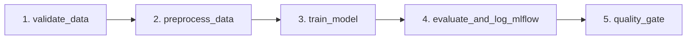

# Assignment 03: Building a Production-Ready MLOps AI Agent

A production-grade, autonomous AI Agent that manages end-to-end Machine Learning Operations (MLOps) workflows across data versioning, experiment tracking, workflow scheduling, and Kubernetes deployments.

---

## 1. Project Overview

The **MLOps AI Agent** bridges the gap between natural language developer intentions and production infrastructure. Given a goal such as *"Train model on new data, verify metrics exceed thresholds, register in MLflow, and deploy to Kubernetes"*, the agent:
1. Plans and reasons over MLOps operational steps.
2. Interacts with **DVC** for dataset & artifact reproducibility.
3. Tracks metrics, parameters, and registers artifacts with **MLflow**.
4. Triggers and monitors asynchronous DAG pipelines in **Apache Airflow**.
5. Validates deployment policies and applies zero-downtime manifests in **Kubernetes**.
6. Enforces enterprise guardrails, strict namespace isolation, and automatic secret redaction.

---

## 2. Architecture Summary

The agent architecture comprises four major layers:
- **Reasoning & Orchestration Layer**: Autonomous LLM planner coordinating step-by-step tool actions.
- **Guardrail & Safety Layer**: Enforces namespace constraints (`mlops-prod` only), metric thresholds, and credential masking.
- **Tool Domain Layer**: Standardized Pydantic v2 execution interfaces for DVC, MLflow, Airflow, and Kubernetes.
- **Observability Layer**: Structured JSON logging capturing `request_id`, `tool_name`, `status` (`SUCCESS`, `ERROR`, `BLOCKED`), and `duration_ms`.

Detailed architecture diagrams and workflows are available in [architecture.md](architecture.md).

---

## 3. Directory Structure

```
├── .github/
│   └── workflows/
│       └── ci.yml                 # GitHub Actions CI workflow (linting & testing)
├── agent/
│   ├── __init__.py                # Package exports
│   ├── logger.py                  # Structured JSON logger with secret redaction
│   ├── main.py                    # Agent CLI entrypoint
│   ├── orchestrator.py            # Workflow orchestration & planning engine
│   ├── schemas.py                 # Pydantic v2 domain schemas & ToolExecutionResult
│   └── tools/
│       ├── __init__.py
│       ├── airflow_tools.py       # Airflow 3 REST API client integration
│       ├── dvc_tools.py           # DVC CLI/API tracking & reproduction
│       ├── kubernetes_tools.py    # K8s deployment, health, rollback & guardrails
│       └── mlflow_tools.py        # MLflow tracking and registry operations
├── api/
│   ├── __init__.py
│   └── main.py                    # FastAPI model inference & health service
├── dags/
│   └── training_pipeline.py       # Airflow training pipeline DAG
├── data/
│   └── .gitkeep                   # Dataset directory tracked by DVC
├── kubernetes/
│   ├── configmap.yaml             # API configuration and environment settings
│   ├── deployment.yaml            # Rolling update deployment manifest
│   └── service.yaml               # ClusterIP service definition
├── screenshots/
│   └── .gitkeep                   # Verification screenshots
├── tests/
│   └── __init__.py                # Automated test suite
├── training/
│   ├── __init__.py
│   └── train.py                   # Model training script with MLflow logging
├── .env.example                   # Environment variable template
├── .gitignore                     # Git ignore rules for MLOps artifacts
├── Dockerfile                     # Container image specification for model API
├── dvc.yaml                       # DVC reproducible pipeline stages
├── pyproject.toml                 # Project metadata and dependencies
├── architecture.md                # System design & architecture documentation
└── README.md                      # Project documentation
```

---

## 4. Getting Started

### 4.1 Prerequisites
- Python >= 3.10 (Python 3.11 recommended)
- Git (configured locally)
- (Optional) Docker, Minikube / Kind for local Kubernetes testing

### 4.2 Virtual Environment Setup

Create and activate a virtual environment:

```bash
# Windows (PowerShell)
python -m venv .venv
.\.venv\Scripts\Activate.ps1

# Linux / macOS
python3 -m venv .venv
source .venv/bin/activate
```

### 4.3 Dependency Installation

Install the project in editable mode with development dependencies:

```bash
pip install --upgrade pip
pip install -e ".[dev]"
```

### 4.4 Environment Configuration

Copy `.env.example` to `.env` and configure your API keys and endpoints:

```bash
cp .env.example .env
```

Key environment variables:
- `LLM_API_KEY`: API key for Gemini or OpenAI-compatible model provider.
- `LLM_MODEL`: Target model (e.g., `gemini-2.5-flash`).
- `MLFLOW_TRACKING_URI`: MLflow tracking server (default: `http://localhost:5000`).
- `AIRFLOW_BASE_URL`: Airflow 3 API base URL (default: `http://localhost:8080/api/v2`).
- `K8S_APPROVED_NAMESPACE`: Permitted Kubernetes deployment namespace (`mlops-prod`).
- `DVC_REMOTE_NAME`: DVC remote storage identifier (`local_remote`).

---

## 5. Running the Agent & Services

### Running the Agent CLI
```bash
python -m agent.main --goal "Train iris model and deploy to mlops-prod"
```

### Running the Inference API Locally
```bash
uvicorn api.main:app --host 0.0.0.0 --port 8000 --reload
```
Access the interactive API docs at [http://localhost:8000/docs](http://localhost:8000/docs).

### Running Tests and Linting
```bash
# Run test suite
pytest

# Run linter
ruff check .
```

---

## 6. Task 1: DVC Data Management

The DVC Data Management Agent (`agent/tools/dvc_tools.py`) provides safe, allowlisted subprocess interactions with DVC and Git to inspect, track, compare, and reproduce dataset versions. Every call returns a standardized `ToolExecutionResult` from `agent/schemas.py` and emits structured JSON logs with secret redaction.

### 6.1 Dataset Generation & DVC Pipeline Setup

1. **Generate Synthetic Classification Data**:
   ```bash
   # Generate v1 baseline dataset (1,000 samples)
   python -m training.generate_data --version v1 --output data/dataset.csv

   # Optionally generate v2 drifted dataset (1,250 samples)
   python -m training.generate_data --version v2 --output data/dataset.csv
   ```

2. **Initialize DVC and Configure Local Remote Storage**:
   ```bash
   dvc init
   dvc remote add -d local_remote .dvc_storage
   ```

3. **Track Dataset with DVC**:
   ```bash
   dvc add data/dataset.csv
   dvc push
   ```

4. **Run Reproducible Pipeline (`dvc.yaml`)**:
   ```bash
   dvc repro
   ```
   This executes the two-stage reproducible pipeline:
   - `validate_data`: checks schema, row count, nulls, and emits `data/validation_report.json`.
   - `train`: trains Random Forest model, outputs `models/model.joblib`, and writes `metrics.json`.

### 6.2 DVC Agent Tools

The 5 callable tools in `agent/tools/dvc_tools.py` include:

| Tool Function | Description |
|---|---|
| `list_dvc_tracked_datasets()` | Scans repository for `.dvc` files and pipeline datasets. |
| `get_current_dataset_version()` | Retrieves MD5 hash, dataset version label, Git commit, and DVC remote. |
| `compare_dataset_versions(rev1, rev2)` | Computes hash and size differences between revisions or states. |
| `detect_data_changes()` | Checks `dvc status` to detect modified data or pipeline dependencies. |
| `explain_dataset_reproduction(rev)` | Returns exact, verified commands to reproduce a previous dataset version. |

### 6.3 Security & Allowlist Enforcement

All subprocess calls enforce strict security rules:
- **No `shell=True`**: All commands are executed as parameter lists.
- **Root Command Allowlist**: Only `dvc` and `git` are permitted.
- **Subcommand Allowlist**: Strictly limited to read-only or approved operations (`status`, `list`, `diff`, `metrics`, `params`, `remote`, `checkout`, `pull`, `push`, `repro`, `dag`, `rev-parse`, `log`, `show`).
- **Shell Injection Prevention**: Arguments are checked for forbidden characters (`;`, `&`, `|`, `` ` ``, `$`, `>`, `<`).

### 6.4 Running Task 1 Tests

Run the automated test suite for the DVC tools:

```bash
pytest tests/test_dvc_tools.py -v
```

---

## 7. Task 2: MLflow Experiment Intelligence

The MLflow Experiment Intelligence Agent (`agent/tools/mlflow_tools.py`) uses `mlflow.tracking.MlflowClient` exclusively to programmatically audit experiments, evaluate candidate runs against multi-criteria production readiness policies, compare model performance trade-offs, and inspect the MLflow Model Registry.

### 7.1 Running the Modular Training Pipeline

The training script (`training/train.py`) executes a modular scikit-learn training workflow:
- **Data Validation**: Asserts schema, row count (>= 50), missingness, and minority class balance.
- **Preprocessing**: Stratified train/test splitting (`X_train`, `X_test`, `y_train`, `y_test`).
- **Model Training**: Configurable between Random Forest, Gradient Boosting, and Logistic Regression.
- **Evaluation**: Computes accuracy, precision, recall, F1 score, ROC-AUC, and train-test overfitting gap.
- **Quality Gate**: Asserts minimum F1 threshold (`>= 0.75`) and bounded overfitting gap (`<= 0.20`).
- **Provenance Logging**: Automatically logs hyperparameters, metrics, model artifacts, and provenance tags (`dataset_version`, `dvc_md5`, `git_commit`, `quality_gate_passed`, `quality_gate_reason`).

#### Example Training Commands:
```bash
# 1. Balanced Random Forest (Baseline - Passes Quality Gate)
python -m training.train --model-type random_forest --n-estimators 100 --max-depth 5

# 2. High-Complexity Random Forest (High capacity / Overfitting evaluation)
python -m training.train --model-type random_forest --n-estimators 250 --max-depth 15

# 3. Gradient Boosting Classifier (High performance)
python -m training.train --model-type gradient_boosting --n-estimators 100 --learning-rate 0.08 --max-depth 3

# 4. Logistic Regression (Linear model)
python -m training.train --model-type logistic_regression --c-param 1.0

# 5. Underfitted Random Forest (Fails Quality Gate: F1 < 0.75)
python -m training.train --model-type random_forest --n-estimators 5 --max-depth 1 --min-f1 0.75
```

### 7.2 Launching the MLflow UI

View experiments, metrics curves, and the Model Registry in the browser:

```bash
# Launch MLflow UI connected to the SQLite backend
mlflow ui --backend-store-uri sqlite:///mlflow.db --port 5000
```
Open [http://localhost:5000](http://localhost:5000) in your web browser.

### 7.3 MLflow Agent Tools

The 5 callable tools in `agent/tools/mlflow_tools.py` include:

| Tool Function | Description |
|---|---|
| `list_experiments_and_runs()` | Lists active experiments and recent training runs with statuses, timestamps, and parameters. |
| `get_run_details(run_id)` | Retrieves full metrics, hyperparameters, artifact paths, and dataset provenance tags (`dataset_version`, `git_commit`, `dvc_md5`). |
| `find_best_run(exp, metric, min_threshold)` | Finds top-performing candidate and performs comprehensive production-readiness check (quality gate, overfitting gap, provenance audit). **Explicitly verifies that highest metric score alone does not guarantee production readiness.** |
| `compare_runs(run_ids)` | Side-by-side comparative matrix across metrics, hyperparameters, and dataset versions with trade-off analysis. |
| `get_model_registry_info(model_name)` | Inspects registered models, current versions, lifecycle stages, and aliases. |

### 7.4 Running Task 2 Tests

Run the automated test suite for the MLflow intelligence tools:

```bash
pytest tests/test_mlflow_tools.py -v
```

---

## 8. Task 3: Apache Airflow Workflow Automation

The Airflow Workflow Automation Agent (`agent/tools/airflow_tools.py`) and training DAG (`dags/training_pipeline.py`) provide end-to-end orchestration and asynchronous management of model training pipelines through the Airflow 3 / 2 REST API.

### 8.1 5-Stage Airflow DAG Architecture (`mlops_model_training_pipeline`)

The DAG organizes the end-to-end pipeline into 5 strictly sequential stages:



1. **`validate_data`**: Asserts `data/dataset.csv` exists, has at least 50 records, contains required target column, has null ratio `<= 0.05`, and captures the DVC content hash. Raises `ValueError` to abort the pipeline early on invalid data.
2. **`preprocess_data`**: Splits features and target with stratification, writing partitioned numpy arrays to `data/processed/`.
3. **`train_model`**: Trains the Random Forest classifier and checkpoints the model to `models/candidate_model.joblib`.
4. **`evaluate_and_log_mlflow`**: Evaluates model metrics (Accuracy, Precision, Recall, F1, ROC-AUC), logs parameters and tags (`git_commit`, `dvc_md5`) to MLflow, and exports cloudpickle model artifacts.
5. **`quality_gate`**: Evaluates candidate model performance against strict production thresholds (`f1_score >= 0.75` and `accuracy >= 0.75`). If criteria fail, raises a `RuntimeError` to block deployment; if criteria pass, promotes/registers the model in the MLflow Model Registry.

### 8.2 Execution & Configuration

The DAG tasks can be tested standalone or scheduled within Apache Airflow:

```bash
# Test all 5 DAG stages standalone in Python
python -c "
from dags.training_pipeline import *
task_validate_data()
task_preprocess_data()
task_train_model()
task_evaluate_and_log_mlflow()
task_quality_gate()
"
```

Configure your Airflow connection in `.env`:
- `AIRFLOW_BASE_URL`: Airflow API endpoint (default: `http://localhost:8080/api/v2`).
- `AIRFLOW_USERNAME`: Basic auth username.
- `AIRFLOW_PASSWORD`: Basic auth password.
- `AIRFLOW_API_TOKEN`: Optional Bearer token authentication.

### 8.3 Airflow Agent Tools & Security Guardrails

The 5 callable tools in `agent/tools/airflow_tools.py` include:

| Tool Function | Description |
|---|---|
| `list_available_dags()` | Queries `/dags` to retrieve available DAGs, pause status, and schedules. |
| `get_dag_run_status(dag_id, dag_run_id)` | Inspects execution state (`queued`, `running`, `success`, `failed`) and run timestamps. |
| `trigger_training_dag(dag_id, conf)` | Validates DAG against `APPROVED_DAGS` allowlist and triggers a new run via POST `/dags/{dag_id}/dagRuns`. **Rejects unapproved DAGs with `BLOCKED` status.** |
| `identify_failed_tasks(dag_id, dag_run_id)` | Queries task instances to detect failed or upstream-failed tasks. |
| `get_task_diagnostics(dag_id, dag_run_id, task_id)` | Fetches task logs and analyzes error patterns to provide actionable remediation steps. |

### 8.4 Running Task 3 Tests

Run the automated test suite for the Airflow DAG and workflow tools:

```bash
pytest tests/test_airflow_tools.py -v
```


