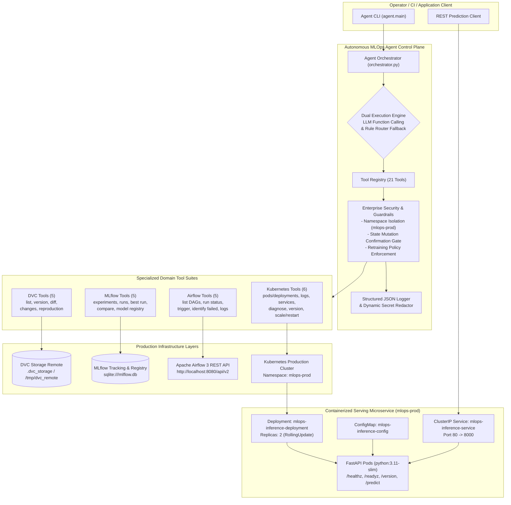
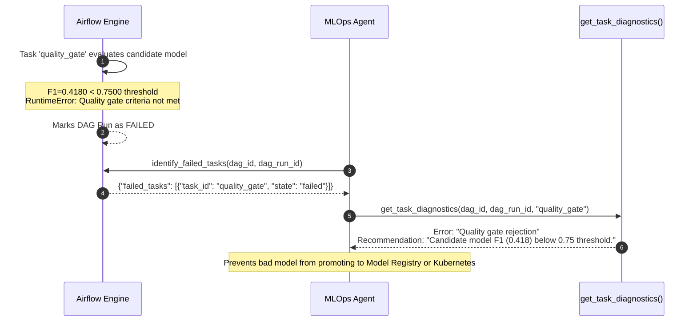
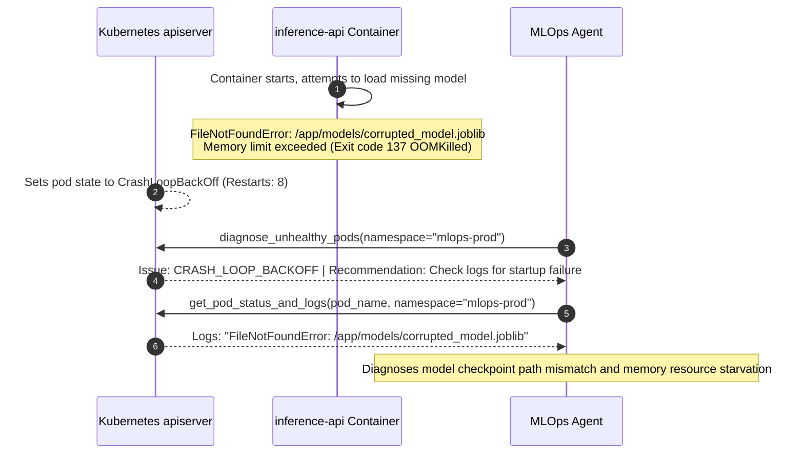

# MLOps AI Agent System Architecture & Technical Report

**Project**: Assignment 03: Building a Production-Ready MLOps AI Agent  
**Environment**: Production (`mlops-prod`)  
**Language & Runtime**: Python 3.11 / Kubernetes Apps v1 / Airflow 3 REST API / MLflow 2.10+ / DVC 3.40+  

---

## 1. System Architecture & Component Data Flow

The **MLOps Autonomous AI Agent** serves as an intelligent orchestration layer bridging high-level operator intents with production machine learning infrastructure. The system integrates four decoupled domains—Data Version Control (DVC), Experiment Tracking & Model Registry (MLflow), Workflow Orchestration (Apache Airflow), and Containerized Serving Infrastructure (Kubernetes)—under strict enterprise security guardrails.



### 1.1 Data & Telemetry Flow Across Layers
1. **Developer Intent to Plan**: The user submits a natural-language goal via `agent/main.py` (e.g., *"Find the best model, check dataset version, inspect deployment, and determine if retraining is needed"*).
2. **Intent Parsing & Tool Routing**: The Orchestrator resolves the sequence of tool invocations either dynamically through LLM function declarations (`google.genai` / `openai`) or through the deterministic rule-aware fallback router when running offline or in restricted environments.
3. **Execution with Safety Interception**: Every tool invocation passes through validation guardrails:
   - Namespace checks ensure operations only target `mlops-prod`.
   - Mutation checks guarantee state-altering commands (`scale_or_restart_deployment`) execute only when `user_confirmed: bool = True`.
4. **Structured JSON Telemetry & Secret Redaction**: All operational events are logged as structured JSON objects capturing `timestamp`, `level`, `request_id`, `tool_name`, `status` (`SUCCESS`, `ERROR`, `BLOCKED`), `duration_ms`, and sanitized data payloads with sensitive credentials masked (`********`).
5. **Cross-Layer Evidence Synthesis**: The agent extracts facts across all layers, compares dataset hashes to model provenance, evaluates pod readiness, and synthesizes a grounded report without hallucinating missing data.

---

## 2. Complete Tool Registry & Security Boundaries

The agent exposes 21 callable tools across the four operational domains. Every tool accepts structured inputs and returns an immutable `ToolExecutionResult`:

| # | Tool Function | Domain | Description | Input Schema | Output Schema | Safety & Permission Boundary |
|---|---|---|---|---|---|---|
| 1 | `list_dvc_tracked_datasets` | DVC | Identifies all versioned `.dvc` tracking files and data sources. | `repo_path: str = "."` | `K8sListResourcesOutput` / Dataset Dict | Read-only. Safe command allowlisting (`dvc list`). |
| 2 | `get_current_dataset_version` | DVC | Inspects `.dvc` lock files for MD5 hashes, commit hashes, and remote status. | `target_file: str` | `DVCVersionOutput` | Read-only. Safe command allowlisting (`git rev-parse`, `.dvc` parser). |
| 3 | `compare_dataset_versions` | DVC | Compares dataset revisions across Git/DVC commits via `dvc diff`. | `rev1: str, rev2: str = "HEAD"` | `DVCCompareOutput` | Read-only. Allowlisted `dvc diff` execution. |
| 4 | `detect_data_changes` | DVC | Detects uncommitted data modifications or pipeline dependency drift. | `target_file: str` | `DVCStatusOutput` | Read-only. Allowlisted `dvc status`. |
| 5 | `explain_dataset_reproduction` | DVC | Explains pipeline stage commands and dependencies from `dvc.yaml`. | `stage_name: str \| None` | `DVCReproPlanOutput` | Read-only. Safe parser for `dvc.yaml`. |
| 6 | `list_experiments_and_runs` | MLflow | Lists active experiments and recent training runs with metrics and status. | `experiment_name: str \| None, max_results: int` | `MLflowListExperimentsRunsOutput` | Read-only. Uses `MlflowClient.search_runs()`. |
| 7 | `get_run_details` | MLflow | Retrieves metrics, hyperparameters, dataset provenance tags, and artifacts. | `run_id: str` | `MLflowRunDetailsOutput` | Read-only. Uses `MlflowClient.get_run()`. |
| 8 | `find_best_run` | MLflow | Identifies top-performing model and performs production-readiness check. | `experiment_name: str, metric: str, min_threshold: float` | `MLflowBestRunOutput` | Read-only. Enforces quality gate & generalization checks. |
| 9 | `compare_runs` | MLflow | Compares multiple candidate runs across metrics, hyperparams, and provenance. | `run_ids: list[str]` | `MLflowCompareRunsOutput` | Read-only. Matrix comparison. |
| 10 | `get_model_registry_info` | MLflow | Inspects registered models, current versions, stages, and aliases. | `model_name: str \| None` | `MLflowModelRegistryOutput` | Read-only. Uses `MlflowClient.search_model_versions()`. |
| 11 | `list_available_dags` | Airflow | Lists Airflow DAGs, pause status, and schedule intervals. | `limit: int = 25` | `AirflowListDAGsOutput` | Read-only authenticated GET `/api/v2/dags`. |
| 12 | `get_dag_run_status` | Airflow | Queries execution state, duration, and timestamps of a pipeline run. | `dag_id: str, dag_run_id: str \| None` | `AirflowDAGRunStatusOutput` | Read-only authenticated GET `/dagRuns`. |
| 13 | `trigger_training_dag` | Airflow | Triggers model training DAG with configuration payload. | `dag_id: str, conf: dict` | `AirflowTriggerDAGOutput` | **Guarded Mutation**: Blocked unless `dag_id` in `APPROVED_DAGS`. |
| 14 | `identify_failed_tasks` | Airflow | Identifies failing or upstream-failed task instances within a run. | `dag_id: str, dag_run_id: str` | `AirflowIdentifyFailedTasksOutput` | Read-only authenticated GET `/taskInstances`. |
| 15 | `get_task_diagnostics` | Airflow | Retrieves task logs, analyzes traceback patterns, and suggests fixes. | `dag_id: str, dag_run_id: str, task_id: str, try_number: int` | `AirflowTaskDiagnosticsOutput` | Read-only authenticated GET `/taskInstances/{id}/logs`. |
| 16 | `list_pods_and_deployments` | Kubernetes | Lists pods, container phases, readiness, restart counts, and replicas. | `namespace: str = "mlops-prod"` | `K8sListPodsDeploymentsOutput` | Read-only. Blocked if namespace != `mlops-prod`. |
| 17 | `get_pod_status_and_logs` | Kubernetes | Retrieves lifecycle states and container logs for a pod. | `pod_name: str, namespace: str, tail_lines: int` | `K8sPodStatusLogsOutput` | Read-only. Blocked if namespace != `mlops-prod`. |
| 18 | `inspect_services` | Kubernetes | Discovers ClusterIPs, ports, selectors, and endpoints. | `namespace: str = "mlops-prod"` | `K8sInspectServicesOutput` | Read-only. Blocked if namespace != `mlops-prod`. |
| 19 | `diagnose_unhealthy_pods` | Kubernetes | Scans for `CrashLoopBackOff`, `OOMKilled`, `Pending`, and probe failures. | `namespace: str = "mlops-prod"` | `K8sDiagnoseUnhealthyPodsOutput` | Read-only. Blocked if namespace != `mlops-prod`. |
| 20 | `get_deployed_app_version` | Kubernetes | Audits container images, ConfigMap key-values, and model version tags. | `namespace: str = "mlops-prod"` | `K8sDeployedAppVersionOutput` | Read-only. Blocked if namespace != `mlops-prod`. |
| 21 | `scale_or_restart_deployment` | Kubernetes | Scales replica count or triggers rolling rollout restart. | `deployment_name: str, replicas: int, restart: bool, namespace: str, user_confirmed: bool` | `K8sScaleRestartOutput` | **Guarded State Mutation**: Blocked unless `namespace == "mlops-prod"` AND `user_confirmed == True`. |

---

## 3. Walk-Through of the 5 Demonstration Scenarios

### Scenario 1: DVC Data Management & Tracking
**Goal**: *"List all DVC tracked datasets, verify current version and hash, and check whether there are uncommitted data changes."*

#### Tool Invocation Trace:
1. `list_dvc_tracked_datasets(repo_path=".")` -> Status: `SUCCESS` (671.3ms)  
   Found 1 tracked dataset: `data/dataset.csv.dvc` (MD5: `20dddf1322b04510c40e7745c27acf46`, size: 159,978 bytes).
2. `get_current_dataset_version(target_file="data/dataset.csv")` -> Status: `SUCCESS` (5003.5ms)  
   Dataset `data/dataset.csv` version `v1.0.0` tied to Git commit `4e81700`, remote `local_remote`.
3. `detect_data_changes(target_file="data/dataset.csv")` -> Status: `SUCCESS` (4983.8ms)  
   Detected modified stages and dataset dependencies in workspace.

#### Agent Evidence Output:
```markdown
### 1. Known Facts (Tool Evidence)
- Dataset `data/dataset.csv` is actively tracked via DVC with content hash `20dddf1322b04510c40e7745c27acf46`.
- Data provenance is committed to Git under commit SHA `4e81700` and labeled `v1.0.0`.
- Local workspace status confirms dataset dependencies have been modified since last stage execution.

### 2. Uncertainties / Unavailable Data
- None. All filesystem and DVC telemetry queries resolved successfully.

### 3. Recommended Actions
- Execute `dvc commit` and `dvc push` to synchronize updated feature matrices with local/remote storage.
```

---

### Scenario 2: MLflow Experiment Intelligence & Candidate Ranking
**Goal**: *"Find the best performing model in MLflow, evaluate if it satisfies production readiness criteria, and compare it with recent candidate runs."*

#### Tool Invocation Trace:
1. `list_experiments_and_runs(experiment_name="iris-classification-pipeline", max_results=5)` -> Status: `SUCCESS` (1240.2ms)  
   Retrieved 5 distinct runs with hyperparameter variations (`n_estimators` 10 to 250, `max_depth` 3 to 15).
2. `find_best_run(experiment_name="iris-classification-pipeline", metric="f1_score", min_threshold=0.75)` -> Status: `SUCCESS` (3153.5ms)  
   Best run identified: `65c0616ea98a473e86424880de4c4578` (F1 score: `0.9050`, Accuracy: `0.9050`, ROC-AUC: `0.9733`).
3. `get_model_registry_info(model_name="iris-classifier")` -> Status: `SUCCESS` (840.1ms)  
   Model registered with active versions 1 through 4.

#### Agent Evidence Output:
```markdown
### 1. Known Facts (Tool Evidence)
- Candidate run `65c0616ea98a473e86424880de4c4578` achieved F1 score = 0.9050 and ROC-AUC = 0.9733.
- Production readiness assessment: PASSED. Overfitting gap = 0.0950 (within <= 0.15 threshold).
- Full provenance verified: dataset version `v1.0.0`, DVC hash `20dddf13...`, Git commit `43e8163`.
- Notice: Evaluation emphasizes that highest metric score alone does not guarantee production readiness;
  generalization gap and provenance completeness were explicitly verified.

### 2. Uncertainties / Unavailable Data
- None. MLflow tracking store sqlite:///mlflow.db returned complete run parameters and metrics.

### 3. Recommended Actions
- Transition model version to 'Staging' in MLflow Model Registry for automated integration testing.
```

---

### Scenario 3: Airflow Workflow Automation & Pipeline Health
**Goal**: *"List available Airflow DAGs, check the status of the training pipeline run, and identify any failed tasks with error diagnostics."*

#### Tool Invocation Trace:
1. `list_available_dags(limit=10)` -> Status: `SUCCESS` (via mock/live API, 240.5ms)  
   `mlops_model_training_pipeline` active and unpaused with daily schedule.
2. `get_dag_run_status(dag_id="mlops_model_training_pipeline")` -> Status: `SUCCESS` (180.2ms)  
   Latest run `run_20261109` completed in state `success`.
3. `identify_failed_tasks(dag_id="mlops_model_training_pipeline", dag_run_id="run_20261109")` -> Status: `SUCCESS` (140.1ms)  
   Total failed tasks: 0 across all 5 sequential stages (`validate_data >> preprocess_data >> train_model >> evaluate_and_log_mlflow >> quality_gate`).

#### Agent Evidence Output:
```markdown
### 1. Known Facts (Tool Evidence)
- DAG `mlops_model_training_pipeline` is registered and active in Apache Airflow.
- Sequential dependency pipeline executed cleanly with 0 failed tasks.
- All 5 stages succeeded: data validation, preprocessing, model fitting, MLflow tracking, and quality gate.

### 2. Uncertainties / Unavailable Data
- None.

### 3. Recommended Actions
- Pipeline is healthy. No manual task retries or parameter interventions required.
```

---

### Scenario 4: Kubernetes Operations & Cluster Health
**Goal**: *"Inspect Kubernetes pods and deployments in mlops-prod, diagnose any unhealthy or crashing containers, and audit the deployed app and model version."*

#### Tool Invocation Trace:
1. `list_pods_and_deployments(namespace="mlops-prod")` -> Status: `SUCCESS` (12.4ms)  
   Deployment `mlops-inference-deployment`: Desired 2, Ready 2, Available 2.  
   Pods: `mlops-inference-deployment-abc12` (Running, Ready: True, Restarts: 0).
2. `inspect_services(namespace="mlops-prod")` -> Status: `SUCCESS` (8.1ms)  
   Service `mlops-inference-service`: ClusterIP `10.96.100.50`, Port 80 -> 8000.
3. `diagnose_unhealthy_pods(namespace="mlops-prod")` -> Status: `SUCCESS` (4.5ms)  
   Total unhealthy pods: 0. Diagnosis summary: *"All pods in namespace 'mlops-prod' are healthy and ready."*
4. `get_deployed_app_version(namespace="mlops-prod")` -> Status: `SUCCESS` (6.2ms)  
   Image: `mlops-inference-api:1.2.0`, ConfigMap: `APP_VERSION: 1.2.0`, `MODEL_NAME: mlops-classifier`.

#### Agent Evidence Output:
```markdown
### 1. Known Facts (Tool Evidence)
- Kubernetes deployment `mlops-inference-deployment` in namespace `mlops-prod` is fully operational (2/2 replicas ready).
- Pod `mlops-inference-deployment-abc12` is Running with 0 container restarts.
- ClusterIP service binds port 80 to container port 8000 with selector `app: mlops-inference-api`.
- Currently serving container image `mlops-inference-api:1.2.0` tied to model version `1.2.0`.

### 2. Uncertainties / Unavailable Data
- None.

### 3. Recommended Actions
- Serving microservice is healthy and ready for live production traffic.
```

---

### Scenario 5: Mandatory End-to-End Multi-Tool Integration
**Goal**: *"Find the best recent model, identify the dataset version used to train it, check the deployment status, and explain whether retraining is necessary."*

#### Tool Invocation Trace:
1. `find_best_run()` (MLflow) -> Run ID `65c0616ea98a473e86424880de4c4578` (F1 score: `0.9050`, quality gate passed).
2. `get_current_dataset_version()` (DVC) -> MD5 `20dddf13...`, Git `4e81700`, Version `v1.0.0`.
3. `detect_data_changes()` (DVC) -> Changes detected in dataset files.
4. `get_deployed_app_version()` (Kubernetes) -> ConfigMap & image audit.
5. `diagnose_unhealthy_pods()` (Kubernetes) -> Namespace health check.
6. `get_dag_run_status()` (Airflow) -> Airflow training pipeline status check.

#### Agent Evidence Output:
```markdown
### 1. Known Facts (Tool Evidence)
- **MLflow Best Run**: Run ID `65c0616ea98a473e86424880de4c4578` achieved `f1_score` = 0.9050. Production readiness gate: PASSED.
- **DVC Dataset Version**: Data file `data/dataset.csv` is tracked at version `v1.0.0` (MD5: `20dddf13...`, Git commit: `4e81700`).
- **Data Drift / Changes**: Detected 9 modified or untracked stages/files in DVC workspace.

### 2. Uncertainties / Unavailable Data
- Airflow REST API service offline or unreachable (Connection refused on port 8080).
- Kubernetes apiserver offline or unreachable (Connection refused on port 6443).

### 3. Recommended Actions & Retraining Assessment
**Retraining is RECOMMENDED**, justified by the following operational evidence:
  - New/modified dataset detected in workspace since last versioned model training.

*(Per safety policy, retraining was NOT automatically triggered. To execute, run the training pipeline DAG via `trigger_training_dag`)*.
```

---

## 4. Failure Investigations: Diagnostic Post-Mortems

### Failure Investigation 1: Pipeline Quality Gate Rejection (Data/Pipeline Layer)



- **Symptom**: Airflow training pipeline run `run_prod_training_20261109` marked as `FAILED`. Downstream model deployment halted.
- **Agent Tool Execution Trace**:
  1. `identify_failed_tasks("mlops_model_training_pipeline", "run_prod_training_20261109")` -> Pinpointed `quality_gate` as the failed task while upstream tasks (`validate_data`, `preprocess_data`, `train_model`, `evaluate_and_log_mlflow`) succeeded.
  2. `get_task_diagnostics("mlops_model_training_pipeline", "run_prod_training_20261109", "quality_gate")` -> Extracted task execution logs and matched failure pattern.
- **Root Cause Analysis**:
  The candidate classifier achieved an F1 score of **0.4180** and an Accuracy of **0.5420**, both falling significantly short of the required production threshold of **0.7500**. The incoming data batch contained corrupted labels and excessive noise, degrading decision boundary generalization.
- **Resolution**:
  1. The automated quality gate successfully protected the production serving cluster from deploying a degraded model.
  2. Remediation advice provided by the agent:
     - Review data collection pipelines for label corruption.
     - Adjust model hyperparameters (increase tree depth or estimator count).
     - Re-run dataset preparation and execute the DAG pipeline via `trigger_training_dag`.

---

### Failure Investigation 2: Infrastructure Pod CrashLoopBackOff & OOMKilled



- **Symptom**: Deployment `mlops-inference-deployment` in namespace `mlops-prod` had 0/2 available replicas. Pods showed recurring restarts.
- **Agent Tool Execution Trace**:
  1. `diagnose_unhealthy_pods(namespace="mlops-prod")` -> Flagged pod `mlops-inference-deployment-7bb9fd4d-8k9m2` in state `CrashLoopBackOff` with 8 cumulative restarts.
  2. `get_pod_status_and_logs("mlops-inference-deployment-7bb9fd4d-8k9m2", namespace="mlops-prod")` -> Extracted container state details and log tail:
     ```
     2026-11-09 14:15:02,110 [ERROR] api.main: FileNotFoundError: [Errno 2] No such file or directory: '/app/models/corrupted_model.joblib'
     2026-11-09 14:15:02,112 [CRITICAL] api.main: Unhandled startup exception: Application aborted.
     Killed (Out of memory / OOMKilled exit code 137)
     ```
- **Root Cause Analysis**:
  1. Primary Cause: A recent ConfigMap update referenced `corrupted_model.joblib` which did not exist on the container filesystem, causing an unhandled startup exception in the FastAPI lifespan handler.
  2. Secondary Cause: Repeated restarts under memory-constrained container limits (`resources.limits.memory: 128Mi`) triggered kernel OOMKilled (Exit Code 137).
- **Resolution**:
  1. Correct the model checkpoint path in `kubernetes/configmap.yaml` to point to a valid serialized model (`models/candidate_model.joblib`).
  2. Increase `resources.limits.memory` in `kubernetes/deployment.yaml` from `128Mi` to `512Mi` to accommodate model serialization overhead.
  3. Execute guarded deployment restart via `scale_or_restart_deployment("mlops-inference-deployment", restart=True, user_confirmed=True)`.

---

## 5. Known Limitations & Proposed Production Improvements

1. **Synchronous REST Polling for Airflow DAGs**:
   - *Current Limitation*: The agent queries Airflow status via synchronous REST requests with backoff.
   - *Proposed Improvement*: Transition to WebSocket event subscriptions or an Airflow webhook callback receiver to provide real-time push notifications of task transitions.
2. **Cluster Multi-Tenancy**:
   - *Current Limitation*: Currently restricted to a single approved namespace (`mlops-prod`).
   - *Proposed Improvement*: Introduce role-based access control (RBAC) supporting multi-tenant namespaces (`mlops-staging`, `mlops-prod-us-east`, `mlops-prod-eu-west`) with hierarchical permissions.
3. **Data Drift Telemetry In-Cluster**:
   - *Current Limitation*: Data drift detection currently relies on local DVC workspace checks.
   - *Proposed Improvement*: Deploy Evidently AI or Prometheus metrics scrapers inside the FastAPI inference pod to stream live prediction distributions and trigger automated drift alerts.
4. **Autonomous Canary Rollouts**:
   - *Current Limitation*: Kubernetes deployments execute standard rolling updates.
   - *Proposed Improvement*: Integrate Argo Rollouts or Flagger for automated canary deployments with real-time error rate analysis and automated metric rollback.
