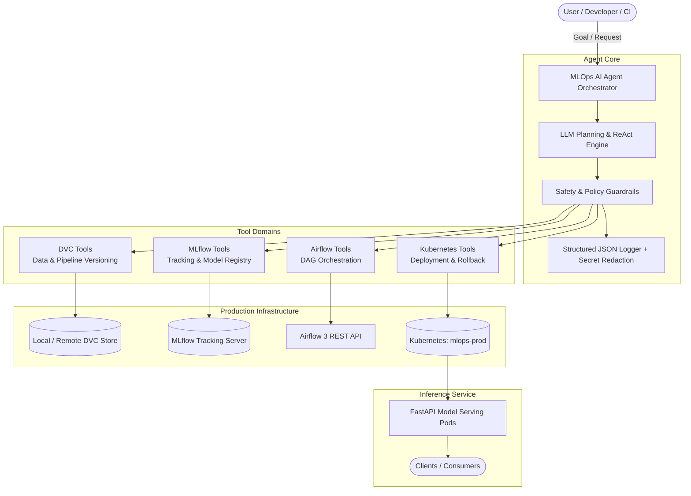
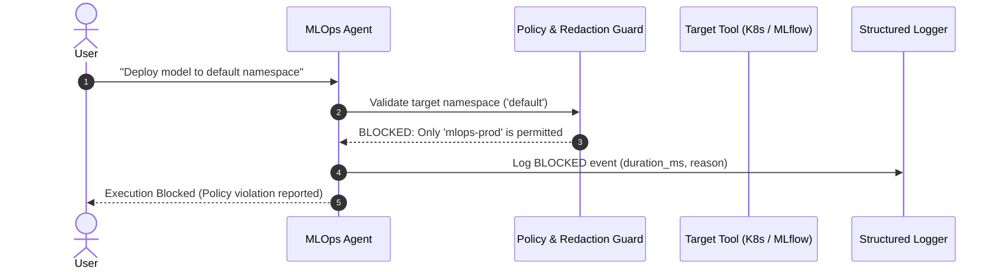

# System Architecture: Production-Ready MLOps AI Agent

This document outlines the architectural blueprint, component design, security guardrails, and orchestration lifecycle for the **Production-Ready MLOps AI Agent**.

---

## 1. High-Level Architecture

The system connects large language model reasoning with production MLOps tools across four domains: Data Versioning (DVC), Experiment Tracking & Model Registry (MLflow), Workflow Orchestration (Airflow), and Containerized Model Deployment (Kubernetes).

---

## 2. Core Components

### 2.1 Agent Orchestration (`agent/`)
- **`orchestrator.py`**: Coordinates goal analysis, multi-step execution plans, state transitions, and error recovery.
- **`schemas.py`**: Strict Pydantic v2 data models for tool inputs, tool outputs, and unified execution receipts (`ToolExecutionResult`).
- **`logger.py`**: Production-grade JSON logger that captures `request_id`, `tool_name`, `status` (`SUCCESS`, `ERROR`, `BLOCKED`), `duration_ms`, and `message`. Implements recursive credential masking for any key matching `TOKEN`, `KEY`, `PASSWORD`, or `SECRET`.

### 2.2 Tool Domains (`agent/tools/`)
1. **DVC Tools (`dvc_tools.py`)**:
   - Manages data versioning, hashes, remote synchronization (`push`/`pull`), and reproducible training pipeline execution (`repro`).
2. **MLflow Tools (`mlflow_tools.py`)**:
   - Manages experiment lifecycles, logs parameters, metrics, model artifacts, and handles Model Registry promotions (`Staging` -> `Production`).
3. **Airflow Tools (`airflow_tools.py`)**:
   - Interacts with Airflow 3 REST API (`/api/v2/dags/{dag_id}/dagRuns`) to trigger training pipelines, query execution states, and poll task status.
4. **Kubernetes Tools (`kubernetes_tools.py`)**:
   - Deploys manifests, executes rolling updates, inspects pod health/restarts, and executes rollbacks if readiness probes fail. Enforces strict namespace boundary validation (`K8S_APPROVED_NAMESPACE = mlops-prod`).

### 2.3 Model Serving API (`api/`)
- Built with **FastAPI** and packaged in a lightweight container.
- Endpoints:
  - `GET /health`: Liveness and readiness probe for Kubernetes.
  - `GET /metadata`: Model version, environment, and tracking server details.
  - `POST /predict`: Real-time inference on Iris feature vectors.

### 2.4 Training Pipeline (`training/` & `dags/`)
- `training/train.py`: Self-contained scikit-learn training script integrated with MLflow autologging / explicit artifact logging.
- `dags/training_pipeline.py`: Airflow DAG orchestrating automated data ingestion, model training, performance threshold validation, and agent notification.

---

## 3. Security & Safety Guardrails

1. **Namespace Isolation**:
   - All Kubernetes operations verify that target namespaces strictly match `K8S_APPROVED_NAMESPACE` (`mlops-prod`). Deployment requests targeting `default`, `kube-system`, or other namespaces are rejected immediately with status `BLOCKED`.
2. **Credential Redaction**:
   - Any log record or tool execution payload containing sensitive keys (`TOKEN`, `KEY`, `PASSWORD`, `SECRET`) or token patterns (e.g., `Bearer ey...`) is scrubbed in memory prior to serialization.
3. **Pre-Deployment Model Validation**:
   - The agent validates that accuracy and F1 metrics meet deployment thresholds before transitioning model registry stages or applying deployment manifests.

