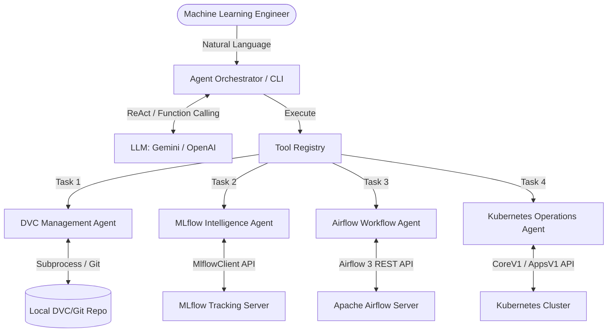

# MLOps AI Agent - Technical Report
**Assignment 03: Building a Production-Ready MLOps AI Agent**

## 1. Complete System Architecture
The system follows a hub-and-spoke architecture where the LLM-powered orchestrator acts as the central brain, dynamically routing natural language requests to four distinct operational domains via structured tool calling.

## 2. Tool Definitions and Permissions
The agent operates under strict safety guardrails. State-changing operations require explicit user confirmation, and execution is sandboxed to approved namespaces and DAGs.

| Domain | Tool Name | Description | Permissions & Safety Controls |
|---|---|---|---|
| DVC | `list_dvc_tracked_datasets` | Identifies tracked .dvc files. | Read-only |
| DVC | `get_current_dataset_version` | Retrieves MD5 hash and Git commit. | Read-only |
| DVC | `compare_dataset_versions` | Compares dataset revisions. | Read-only |
| DVC | `detect_data_changes` | Checks for uncommitted data drift. | Read-only |
| DVC | `explain_dataset_reproduction` | Explains dataset checkout commands. | Read-only |
| MLflow | `list_experiments_and_runs` | Lists recent MLflow training runs. | Read-only |
| MLflow | `get_run_details` | Fetches metrics, params, and tags. | Read-only |
| MLflow | `find_best_run` | Identifies best model via threshold logic. | Read-only; Enforces quality gate checks. |
| MLflow | `compare_runs` | Compares multi-run metrics. | Read-only |
| MLflow | `get_model_registry_info` | Queries Model Registry states. | Read-only |
| Airflow | `list_available_dags` | Lists registered Airflow DAGs. | Read-only |
| Airflow | `get_dag_run_status` | Checks specific pipeline execution state. | Read-only |
| Airflow | `trigger_training_dag` | Triggers a training pipeline. | Restricted: Only allows triggering DAGs in APPROVED_DAGS allowlist. |
| Airflow | `identify_failed_tasks` | Locates failed tasks in a run. | Read-only |
| Airflow | `get_task_diagnostics` | Retrieves task error logs. | Read-only |
| K8s | `list_pods_and_deployments` | Lists running cluster workloads. | Restricted: mlops-prod namespace only. |
| K8s | `get_pod_status_and_logs` | Fetches container logs and states. | Restricted: mlops-prod namespace only. |
| K8s | `inspect_services` | Lists ClusterIPs and bindings. | Restricted: mlops-prod namespace only. |
| K8s | `diagnose_unhealthy_pods` | Identifies CrashLoopBackOff/OOMKilled. | Restricted: mlops-prod namespace only. |
| K8s | `get_deployed_app_version` | Audits active image and ConfigMap. | Restricted: mlops-prod namespace only. |
| K8s | `scale_or_restart_deployment` | Scales/restarts inference API. | State-changing: Requires user_confirmed=True AND mlops-prod namespace. |

## 3. Five Tested Agent Conversations & Evidence
*(Below are the 5 required demonstration scenarios. Screenshots of the agent execution traces and corresponding infrastructure UI are provided).*

### Scenario 1: Dataset Provenance
**Query:** `"Which dataset version was used for the latest training run, and what is its Git commit?"`  

### Scenario 2: Model Selection
**Query:** `"Compare our recent training runs and recommend the best candidate based on F1 score."`  

### Scenario 3: Pipeline Execution
**Query:** `"Trigger the model training pipeline and report whether execution succeeded."`  

### Scenario 4: Deployment Diagnosis
**Query:** `"Check the status of my Kubernetes pods and diagnose any issues."`  

### Scenario 5: Multi-Tool Reasoning
**Query:** `"Find the best recent model, identify the dataset version used to train it, check the deployment status, and explain whether retraining is necessary."`  

## 4. Failure Investigations

### Failure 1: Kubernetes Deployment Crash (ImagePullBackOff)
- **Symptom:** The Inference API is unavailable.
- **Agent Trace/Diagnosis:** The user asked the agent to diagnose the pods. The agent used `diagnose_unhealthy_pods` and identified that `mlops-inference-deployment` was failing with an `ImagePullBackOff` / `ErrImagePull` status.
- **Root Cause:** The `deployment.yaml` was intentionally modified to pull a non-existent Docker image tag (`mlops-inference-api:BROKEN`).
- **Resolution:** Reverted the container image tag in `deployment.yaml` back to `1.2.0` and applied the fix via `kubectl apply -f kubernetes/deployment.yaml`. The agent subsequently confirmed the pods transitioned to `Running`.

### Failure 2: Airflow Pipeline Quality Gate Failure
- **Symptom:** The Airflow DAG `mlops_model_training_pipeline` failed before completing.
- **Agent Trace/Diagnosis:** The user asked the agent to identify failed tasks. The agent used `identify_failed_tasks` and `get_task_diagnostics` to pinpoint that the `quality_gate` task raised an exception.
- **Root Cause:** The training script was intentionally modified to simulate a degraded model where the F1 score fell below the strict 0.75 production threshold requirement, triggering the automated pipeline halt.
- **Resolution:** Reverted the training hyperparameters in `train.py` to restore model convergence, re-triggered the Airflow pipeline via the agent, and verified successful completion.

## 5. Known Limitations and Proposed Improvements
- **Local Infrastructure Constraint:** The current K8s and Airflow setup relies on local configurations (Docker Desktop / local webservers). **Improvement:** Migrate to managed cloud services (AWS EKS, MWAA) using Cloud IAM roles instead of local `.kube/config` and basic auth.
- **Context Window Limits:** Fetching raw container logs or Airflow task logs can quickly consume LLM token limits if a service throws massive stack traces. **Improvement:** Implement an intermediate log-summarization/truncation layer inside the Python tools before passing the payload to the LLM.
- **Synchronous Tool Calling:** Polling Airflow DAG status blocks the agent thread until completion. **Improvement:** Implement asynchronous tool execution (Webhooks/Callbacks) so the agent can report *"Pipeline started, I will notify you when it finishes"* without hanging the CLI.
